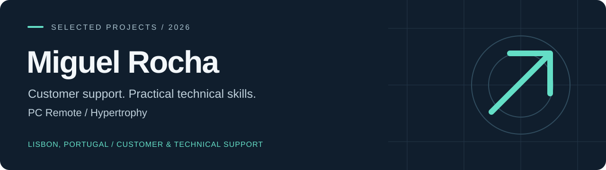
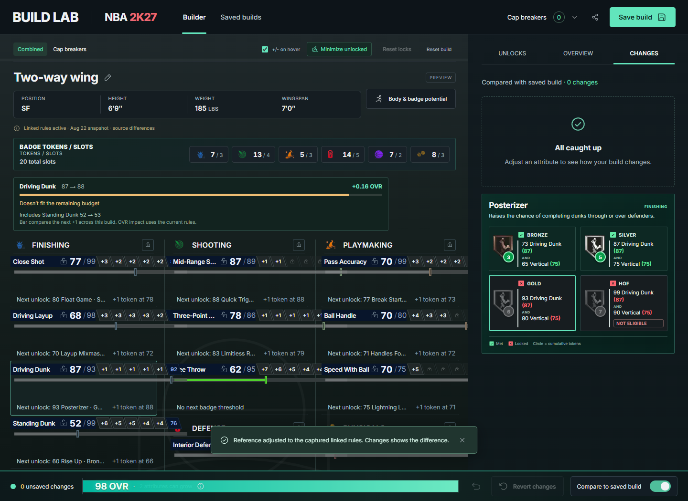

# Building tools for everyday problems

I'm **Miguel Rocha**, based in Lisbon. My projects span web applications, Python services, browser extensions and Blender vehicle modding. I'm looking for **junior developer roles and technology internships in Lisbon or remotely**.

[Start here](#start-here) · [All projects](#all-projects) · [Reviewer guide](docs/REVIEWER-GUIDE.md) · [Validation](docs/VALIDATION.md)

[](https://github.com/mikeywikey-coding/miguel-rocha-portfolio/actions/workflows/ci.yml)

## Start here

### 01 / Build Lab

**Plan an NBA 2K27 build without losing track of linked decisions.**

Changing one attribute can affect the rest of a player build. Build Lab combines a React interface with separate calculation modules, attribute locks, undo, saved builds and comparisons.

`React` `JavaScript` `Vite` `State management` `Node.js tests`



- **Engineering focus:** linked changes, atomic undo, persistent builds, a testable calculation layer and focused UI components.
- **Evidence:** 56 unit tests, 48 Playwright browser tests and the production build run in CI on every push.
- **Scope:** an independent fan project using externally sourced rules, data and calculation inputs. See its source notes for accuracy limitations and attribution.

[Explore Build Lab →](projects/build-lab/)

---

### 02 / Travian Extensions

**Seven browser extensions for Travian, released as a community beta.**

Timers, oasis scoring, settlement forecasts, statistics history and interface improvements for the browser game Travian. Each extension installs separately and has a usage guide with screenshots.

`JavaScript` `Manifest V3` `Service workers` `DOM integration` `Chrome APIs`

- **Engineering focus:** content scripts that adapt to changing game pages, background scheduling, local data stores and per-feature settings.
- **Distribution:** a release zip is published automatically for each new extension version.

[Explore Travian Extensions →](projects/travian-extensions/)

---

### 03 / BMW M4 ADRO Kit

**A collaborative vehicle mod, from Blender work to a published release.**

Blender was the main tool used for the modelling work on this Forza Horizon 6 mod. The release includes **widebody and standard-body variants**, custom exterior parts, interior styling and in-game colour options.

`Blender` `3D modelling` `Vehicle modding` `Release preparation`

[View the published mod on Nexus Mods ↗](https://www.nexusmods.com/forzahorizon6/mods/469)

This is collaborative work, not a claim of sole authorship. Downloads are available on Nexus Mods; large game archives are not stored here.

## All projects

| Project                                                                           | What it does                                                                                        | Main skills                                                  |
| --------------------------------------------------------------------------------- | --------------------------------------------------------------------------------------------------- | ------------------------------------------------------------ |
| [Build Lab](projects/build-lab/)                                                  | NBA 2K27 build planning, linked attributes, saved builds and comparisons                            | React, JavaScript, state management, automated tests         |
| [PC Remote](projects/pc-remote/)                                                  | Controls a Windows PC from a phone over the local network, with paired devices and hardened sign-in | Python, WebSockets, authentication, pytest, touch interfaces |
| [Workout Tracker](projects/workout-tracker/)                                      | Logs training, tracks progress and stores workout history                                           | JavaScript, responsive UI, PWA, local storage                |
| [Travian Extensions](projects/travian-extensions/)                                | Seven browser extensions for Travian: timers, oasis scoring, statistics and interface tools         | Manifest V3, service workers, Chrome APIs, DOM integration   |
| [Next Settlement Calc](projects/travian-extensions/extensions/NextSettlementCalc) | Estimates when culture points reach settlement thresholds                                           | Data parsing, forecasting, event simulation                  |
| [TravAlarm](projects/travian-extensions/extensions/travAlarm)                     | Tracks game events and schedules browser/audio alerts                                               | Manifest V3, service workers, Chrome APIs                    |
| [Travian QoL](projects/travian-extensions/extensions/TravianQoL)                  | Configurable interface improvements and planning tools                                              | Modular JavaScript, DOM integration, persistent settings     |
| [Travian Night Mode](projects/travian-extensions/extensions/travian_night_mode)   | Persistent dark theme for dynamically changing pages                                                | CSS, MutationObserver, preference synchronisation            |
| [BMW M4 ADRO Kit ↗](https://www.nexusmods.com/forzahorizon6/mods/469)             | Published Forza Horizon 6 vehicle mod with two body variants                                        | Blender, 3D modelling, game modding                          |

## Skills in practice

| Area                      | Examples in this portfolio                                                           |
| :------------------------ | :----------------------------------------------------------------------------------- |
| **Frontend development**  | React, JavaScript, responsive HTML/CSS, browser storage                              |
| **Backend & integration** | Python, WebSockets, local network services                                           |
| **Browser tooling**       | Manifest V3, content scripts, service workers, DOM integration                       |
| **Testing & workflow**    | Git, GitHub Actions CI, ESLint, Prettier and Black, unit, browser and security tests |
| **3D work**               | Blender modelling, vehicle modifications and release packaging                       |

## Explore the repository

Each project has its own README covering its purpose, source structure and how to try it. Everything lives under `projects/`.

Start with Build Lab for React and calculation logic, PC Remote for Python, WebSockets and network security, or Travian Extensions for browser integration.

## Quality checks

Every push runs [CI](.github/workflows/ci.yml): ESLint and Prettier across the repository, Black for the Python code, unit tests for Build Lab, PC Remote and Workout Tracker, and Build Lab's production build and Playwright browser tests. To run the same checks locally:

```sh
npm ci
npm run lint && npm run format:check && npm test
```

PC Remote's tests run with Python 3.10 or newer:

```sh
pip install -r projects/pc-remote/requirements-dev.txt black
black --check projects/pc-remote
python -m pytest projects/pc-remote
```

See [docs/VALIDATION.md](docs/VALIDATION.md) for what the tests cover and what still needs a manual check.

## Scope and attribution

Game projects are independent fan projects, not official products. Build Lab includes externally sourced rule data and game-related artwork; see [sources and attribution](ATTRIBUTION.md) and its documented accuracy limitations. M4 downloads are hosted on Nexus Mods, not copied into this repository.

No blanket open-source licence is asserted for third-party assets.
