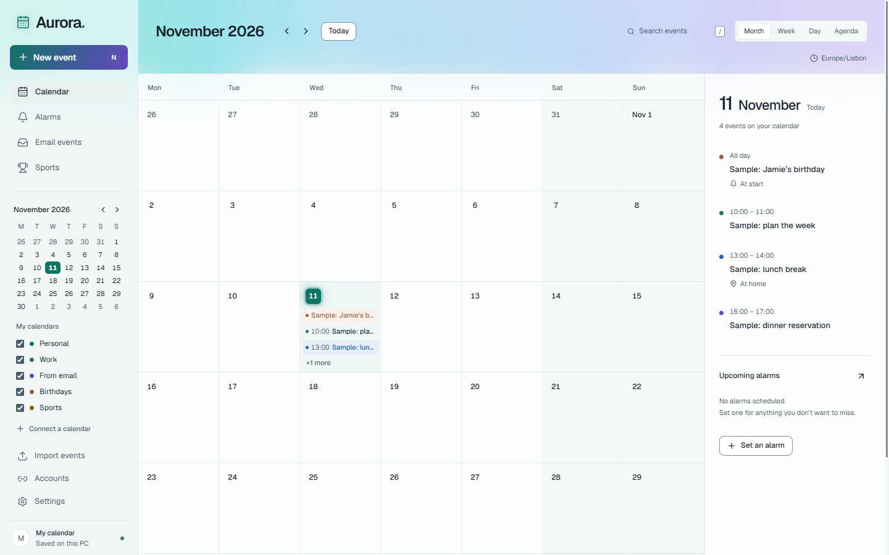

# Aurora

A Windows calendar and alarm app with local storage, recurring reminders, iCloud calendars and birthdays, Google Calendar and Gmail imports, and sports schedules.



## Run from source

Use Node.js 22.12 or later (Node.js 24 LTS recommended) on Windows, then:

```powershell
npm ci
npm run desktop
```

The interface can also be previewed with `npm run dev`. Use the desktop app for background alarms, encrypted account storage, native file dialogs, and account connections.

## Features

- Month, week, day, and agenda views; event search and recurring events.
- One-time and repeating alarms, custom sounds, snooze, and dismissal.
- Close-to-tray operation, optional Windows startup, and overdue reminders after resume.
- Calendar (`.ics`), contact birthday (`.vcf`), and email (`.eml`) import.
- Local backups and restore; credentials are excluded from exported backups.
- iCloud calendars and contact birthdays, with guarded event creation, editing, and deletion.
- Read-only Google Calendar and Gmail access; ordinary email bookings are suggestions for review.
- Sports schedules, followed teams, game alerts, and ESPN box scores. The current build also has optional third-party stream shortcuts; these are separate from the calendar and are not a claim of broadcaster affiliation or distribution rights.

Alarms require Aurora and the PC to be running. Aurora does not wake a sleeping or powered-off PC. Closing the window keeps it in the system tray; quit from the tray menu.

## Account setup

### iCloud and iPhone

In **Accounts → iCloud & iPhone**, enter your Apple Account email and an app-specific password from [Apple Account](https://account.apple.com/). Two-factor authentication is required. Use an app-specific password, not your regular Apple Account password. [Apple setup instructions](https://support.apple.com/en-us/102654).

Calendars and birthday fields from contacts are imported. Contacts stored only on the phone need export or iCloud sync first. Imported contact birthdays are read-only. Saving an event to an iCloud calendar or editing/deleting an existing iCloud event changes it remotely; local-only events stay on this PC. Recurring iCloud event times must be changed on the source device. Calendar reminders remain local.

### Google Calendar and Gmail

In **Accounts → Google & Gmail**, use your own Google Desktop OAuth client, enable the Gmail and Google Calendar APIs, and connect your account. For a personal project in Testing, add your email as a test user. Testing grants can require reconnection after seven days.

The app requests read-only Calendar and Gmail scopes. This repository does not include OAuth client credentials or tokens. A public developer-owned OAuth client and its verification are separate release work; this is currently a bring-your-own-client setup.

Sync runs every five minutes while the app is open or from **Sync now**. Imported events stay available offline. Disconnecting an account keeps imported plans.

## Build and verify

```powershell
npm test
npm run build
npm exec electron -- . --smoke-test --capture
npm run pack
npm run dist
```

`pack` creates an unpacked Windows application. `dist` creates portable and installer builds in `release/`. The smoke test uses temporary data, fake Sample events, and offline sports transport; it exercises startup, renderer isolation, close-to-tray, a background alarm, and snooze. It does not log into real providers.

Live account integration, sleep/resume behavior, and third-party service availability require separate end-to-end checks. Local verification results are documented in [verification](docs/verification.md). The README image contains generated Sample fixtures, not a real calendar.

## Data

Settings shows the local data folder. Calendar writes use an atomic replacement with a previous valid backup. Account credentials use Windows-backed Electron protection. Do not publish or share the application data folder, encrypted account files, calendar caches, or iCloud change logs.

## Steam

See [Steam readiness](docs/steam-readiness.md). Packaging is already available, but a general calendar does not clearly fit Valve's published non-game software categories. Eligibility should be confirmed before paying a Steam Direct fee.

## Third-party code

The Aurora background is adapted from React Bits and retains its applicable attribution and license in [third-party notices](THIRD_PARTY_NOTICES.md). Dependencies retain their own licenses. No standalone license has been selected for Aurora's original code; public source availability alone does not grant additional reuse rights.
