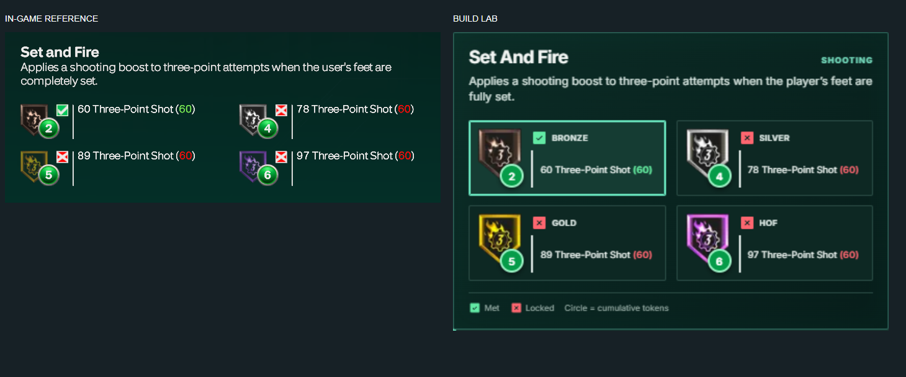

# Build Lab

[Portfolio](../../README.md) · [Usage guide](docs/USAGE.md) · [Accuracy notes](#accuracy) · [Attribution](ATTRIBUTION.md)

React application for NBA 2K27 player planning, with linked attributes, budget constraints and saved-build comparisons.

**React 19 · JavaScript · Vite · Web Workers · Tesseract.js · Playwright**

## Features

- Attribute editing with locks, linked rules and undo.
- Body settings, badge requirements and cap-breaker planning.
- Saved builds, comparisons, shareable links and image export.
- Configuration search in a cancellable Web Worker.
- In-browser screenshot import for review before loading a build.



## Run locally

Requires Node.js 22 (the CI version) and npm. Run from this directory:

```sh
npm ci
npm run dev
```

Open `http://localhost:4173`. `npm run build` writes the production site to `dist/client/`.

## Source guide

| Path                  | Purpose                                               |
| --------------------- | ----------------------------------------------------- |
| `src/Builder.jsx`     | Application state and component wiring                |
| `src/components/`     | Editor, comparisons and dialogs                       |
| `src/storage.js`      | Draft and saved-build persistence                     |
| `src/engine/`         | Attribute rules, projections and configuration search |
| `src/catalogs/`       | Compiled badge, animation and takeover data           |
| `tests/`, `tests/ui/` | Calculation and browser tests                         |

## Validation

```sh
npm test
npm run build
npm run test:ui
```

Linting and formatting are configured at the repository root; run `npm run lint` and `npm run format:check` there.

Unit tests cover linked rules, cap projections, cost curves, locks, share links and configuration search. Playwright covers editing, saved builds and layout at several widths. Browser tests require Playwright's browser installation; see `playwright.config.js` for configuration.

## Accuracy

This is an unofficial planner using externally sourced rules and datasets. It is not a fully verified reproduction of the game. See [feature parity](feature-parity.md), [dataset provenance](research/nba2k27-builder-dataset/README.md) and [attribution](ATTRIBUTION.md) (see also the [repository attribution](../../ATTRIBUTION.md)). The linked-attribute table records its provenance in `src/engine/linked-attributes.json`.

Build Lab is not affiliated with or endorsed by 2K or Take-Two Interactive. NBA 2K names and game imagery belong to their respective owners.
