# Travian Extensions usage

[Project overview](../README.md) · [Installation](#install-in-brave-chrome-or-edge)

## Install in Brave, Chrome, or Edge

1. Download the zip for the extension you want from [Releases](https://github.com/mikeymain/miguel-rocha-portfolio/releases) and extract it. (Or select **Code → Download ZIP** on the repository page; the extensions are under `projects/travian-extensions/extensions`.)
2. Open `brave://extensions`, `chrome://extensions`, or `edge://extensions`.
3. Enable **Developer mode**.
4. Select **Load unpacked**, then choose the extracted extension folder (the one containing `manifest.json`).
5. Repeat for each extension you want to install. Refresh Travian tabs.
6. Pin extensions with toolbar popups. Oasis Finder, TravAlarm, and Travian NPC Calculator add controls to their matching pages.

No build step is required. Game features requiring a paid Travian option still require that option.

### Install in Firefox

1. Download and extract the extension.
2. Open `about:debugging#/runtime/this-firefox`.
3. Click **Load Temporary Add-on** and choose the extension's `manifest.json`.
4. Refresh Travian. Repeat for each extension. Firefox removes temporary add-ons when it exits, so load them again after restarting.

**Domains:** Oasis Finder, TravAlarm, and Travian NPC Calculator target `*.travian.com`. Rank Tracker also supports `.org`, `.net`, `.us`, and `.de`. Next Settlement Calc, QoL, and Night Mode support multiple regional domains; see their manifests. World Watch reads `map.sql` from `.com`, `.org`, `.net`, `.us`, and `.de` worlds.

### Updating and keeping your settings

Replace the files in the same installed folder, click **Reload** in the extension manager, and refresh game tabs. Moving or reinstalling an extension can lose saved data. Export Rank Tracker data before changing installations.

## Oasis Finder

<a href="images/oasis-finder.png">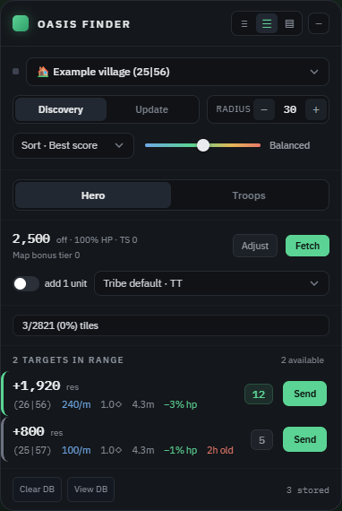</a>

**Features:** Discovery/Update modes, scan coverage, local oasis database, observation ages, Hero/Troops views, hero-stat fetch, troop counts and smithy levels, optional hero inclusion, troop preview/cap, five risk levels, sort controls, density controls, draggable/collapsible panel, database and error viewers. Native farm-list name sorting groups oases by bonus type, then distance.

Click an unoccupied oasis on the map to see the **Clear** table under its animals: how many of the unit chosen under **Troops → Unit** to send from the panel's selected village so no animals survive, and the predicted losses. It uses the smithy levels, Tournament Square, hero and risk settings from the panel; hover a count to see the reserve animals it includes.

The farm list shows the last saved count beside each animal’s unit icon beneath the oasis name. Hover over the counts for the scan time when available. **No animal data** means Oasis Finder has no saved garrison for those coordinates. Run **Update** on the map to refresh known oases.

Select **Inf def** or **Cav def** in the Target header to see the defence score and sort weakest first. Select it again for strongest first. Oases with no saved animal data use the base score of 10 in either direction. Targets without a score follow scored targets within each enabled-first group. Select a native sort header to return to the game’s ordering.

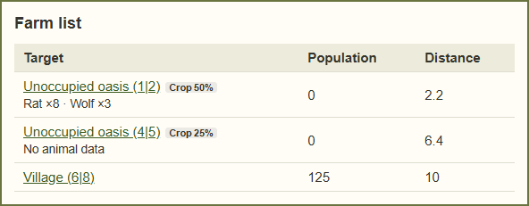

**Usage:**

1. Open the map, select the origin village, and set the radius.
2. Select **Discovery** and pan the map to collect oasis data. Use **Update** to refresh known targets. The coverage meter shows observed areas.
3. In **Hero**, click **Fetch** and check health, Tournament Square level, and map bonus under **Adjust**. In **Troops**, fetch or enter counts and smithy levels; set hero inclusion, **Unit**, and troop cap.
4. Choose a risk level and sort: **Best score**, **Net resources**, **Res / minute**, **Distance**, or **Res / HP**. Net resources includes modeled troop losses.
5. Check observation age and current garrison before raiding. Coordinates open the map; **Send** opens a prefilled rally-point page. Sending the raid requires confirmation in the game.

**Troop sizing.** With no troop counts entered, **Troops** starts from the fewest of the **Unit** choice that clear each oasis within the risk level's loss limit, then adds troops while that raises net resources per troop; every count travels at the same speed, so this is also the best net per troop-minute. It stays within the troop cap and keeps the fewest when no count makes a profit. Targets that need more than the troop cap are hidden. With counts entered, each row shows **Clears** or **×k**, the copies of that team needed. A raid clears when every animal stack rounds to zero survivors: the winner loses x/(1+x) of each unit type, x = (def/att)^1.5, oases add a base defence of 10, and losses round separately for each unit type. With the hero included, hero HP stays within the **Adjust** limit.

| Risk | Reserve animals | Most of each unit type lost |
| --- | --- | --- |
| Safe | 1 per 5 min of scan age + travel, +1 | 2% |
| Cautious | 1 per 5 min | 5% |
| Balanced | 1 per 10 min | 10% |
| Aggressive | 1 per 20 min | 20% |
| Reckless | none | any, if the oasis clears |

Reserve animals cover at most 60 minutes, never exceed the observed animal total, and follow the observed species mix. They are a planning allowance, not measured spawn rates.

Unknown-age or incomplete readings are excluded. **Errors** shows scan problems, and **Clear DB** deletes the oasis cache. In **Detail** density, each target shows its garrison, score, hero XP and res/HP.

**View DB** lists every stored oasis:

- Search by coordinates or animal name. Filter by oasis type (Lumber, Clay, Iron or Crop) and by **With animals** or **No animals**.
- **From** sets the origin: one of your villages, or **Coordinate** to enter any `x|y`. **Radius** limits the list to that distance.
- Click a column header to sort by location, distance, type, garrison, resources or last seen. Click again to reverse.
- **Open N** opens the listed oases in background tabs, in the current sort order. It needs a radius, asks first at 10 or more, opens at most 50 per click, and spaces the tabs 0.35–0.75 s apart.

<a href="images/oasis-database.png">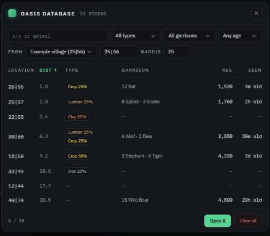</a>

<a href="images/oasis-troops.png">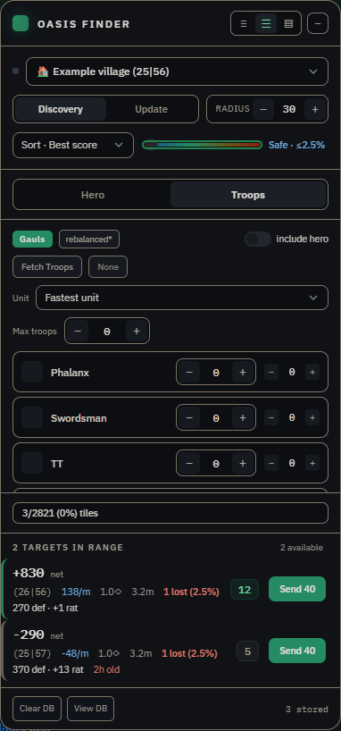</a>

## TravAlarm

<a href="images/travalarm.png">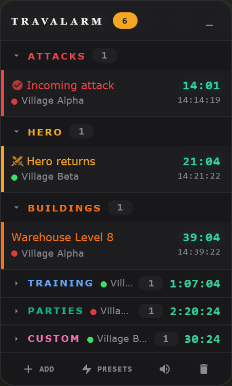</a>

**Features:** grouped timers for attacks, hero movements, construction, training, Academy research and Smithy upgrades (named by unit, with the Smithy target level), training rows coloured per building, storage, celebrations, and farm lists; village labels/colors; custom reminders; recurring/daily presets; countdowns; pin/delete controls; draggable/collapsible panel; category sound settings; volume; browser alarms and notifications. Daily alarms display without an emoji, and the dashboard uses grouped lists without ring gauges. Research and upgrade alarms update when the Academy or Smithy page is opened. An **Oasis respawn** countdown runs to the end of the world's starting beginner protection, when oasis animals begin to respawn, with alarms 45 minutes before and at the protection end.

**Usage:**

1. Open Travian and visit the relevant game pages to populate timers. Expand a category to view its alarms.
2. Click **Add** for a custom reminder. Durations: `15` = 15 minutes, `1:30` = 1 minute 30 seconds, `0:45:00` = 45 minutes. `10pm` schedules the next occurrence on your computer's clock.
3. Use **Presets** for reusable reminders. Selecting the same **Farm List** preset again keeps its deadline, even when it is overdue. Click its timer card to restart its preset interval. Pin or delete timers with their controls.
4. Set volume, enabled categories and the **All sounds** mute under **Sound Settings**. Allow browser notifications for desktop alerts.
5. Drag the widget by its title bar to move it. The position is saved.
6. Click the TravAlarm icon in the browser toolbar for display settings: panel width, opacity, accent color, start minimized, a color for each category and training building, and reset buttons. Changes apply to open Travian tabs immediately.
7. To pause TravAlarm on one server (for example a test world), click the power button in the widget title bar. The server then shows only **TravAlarm · Ignored**; click **Resume** to turn it back on.

Categories keep their fixed order. Within a category, pinned timers come first, then finished ones, then the rest from soonest to latest.

All active alarm countdowns use the same green timer text, including settlers and research. Category colors remain on names and accents.

<a href="images/travalarm-timers.png">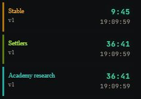</a>

Timers depend on available game data. Browser shutdown, computer sleep, expired sessions, and muted audio can affect alerts.

TravAlarm refreshes game data only while its Travian tab is visible (a second monitor works) and the computer has had input in the last 10 minutes. Hidden tabs, an idle computer or a locked screen pause requests; new attacks are picked up when you return.

## Travian QoL

In Loot Calculator, badge position **X 0, Y 0** uses the default placement. Adjust either value in pixels.

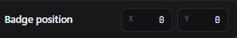

The popup opens on **Build order** the first time. Reopening it restores the last tab you selected by mouse or keyboard.

<a href="images/qol-settings.png">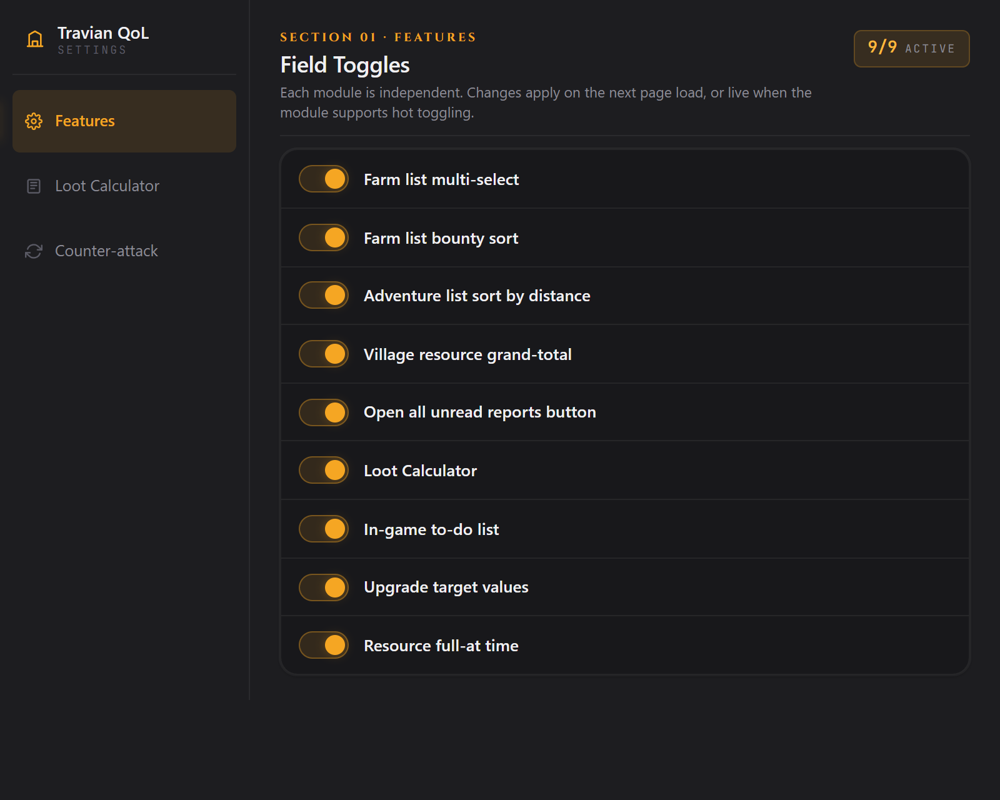</a>

Open the toolbar popup or **Options** page. Features are enabled by default and grouped by area; each feature has its own switch, each group has a switch for all its features, and **All on** / **All off** switch everything. Features tagged **Refresh** take effect after reloading the page; the rest apply immediately.

| Feature | Usage |
| --- | --- |
| Farm-list multi-select | Click a checkbox to set an anchor. **Shift-click** changes a range to the opposite of the anchor's checked state; **Ctrl/Cmd-click** toggles a row. Checked rows are highlighted. Clicking outside lists clears selection. Check the resulting selection before sending raids. |
| Open selected farm targets | **Right-click a checked row → Open N selected targets in tabs**. Opens unique map links from that list in background tabs, starting immediately and spacing the remaining tabs 180 ms apart. No raids are sent. Escape, scrolling, or an outside click closes the menu. |
| Farm-list bounty sort | Choose **By bounty**. Orders by last bounty, high to low; choose **By bounty** again for low to high. Distance breaks ties. Persists through list updates until another sort is selected. Click the arrow above the slot state column to list enabled targets first; click it again to turn that off. |
| Farm-list bag fill | Shows the average bag fill of each target's last 5 raids before the bounty sum, in red below 30%. Hover it for each raid's fill. Raids are recorded when the **Farm List** page shows them. Targets with heroes only or unknown units show nothing. |
| Farm-list oasis kills | For oasis targets, shows the animals killed in the past hour before the bounty sum; hover it for each species. While the **Farm List** page is open and visible, each new oasis raid report is read in the background, one at a time with random gaps of a few seconds. A report already shown when the page opens is not read. |
| Farm-list edit chooser | On the map, a target that is in several farm lists shows one link per list under **Edit farm list**; click one to edit that list's slot. Lists are learned from the **Farm List** page: expand each list once. A note shows how many lists are not loaded yet. |
| Adventure distance sort | Open the hero adventure list. Adventures appear nearest first. |
| Village resource grand-total | Adds wood + clay + iron + crop totals beside village names on per-village resource/production statistics. |
| Open unread reports | Click **Open Unread** beside Archive. Opens unread reports from the displayed page in background tabs. |
| Loot Calculator | Select resource text, then **right-click → Calculate Troops Needed**. Choose tribe and carrying unit. Reports also show unit-count badges. Oasis reports show total resources gained and net resources. The combat simulator shows total resources gained. Set default/per-server units in the **Loot Calculator** settings tab. |
| In-game to-do list | Add, edit, reorder, and complete village-specific tasks. Lists are saved locally; the widget can be dragged or collapsed. |
| Skip builder-bonus ads | Mutes video-feature ads you start and moves them to a corner so the page stays usable; links you open meanwhile load in an overlay so the ad keeps playing. Announces when the ad finishes. The ad always plays at normal speed, and the extension never starts an ad on its own. |
| Upgrade target values | On resource fields, **Production change** shows the difference between the two hourly rates in the game's table. On building pages, the feature compares culture points, population and construction time, e.g. **9 → 10 (+1)** for a level 8 Residence, even when more levels are queued. |
| Build order | On the resources page, the resource field with the shortest payback (cost ÷ hourly gain after crop upkeep) glows; only that one field is marked. The **Build order** tab in QoL settings lists the next 12 upgrades with cost and payback for any village whose resources page has been opened; pick that village's up to three oases (owned or planned) set Gold +25% there, and switch on Simulate to level 20 per village. **Nearby** under the oasis slots ranks the free oases within 3 tiles of the village by extra production per hour; hover or open the oasis tiles around the village on the map to record them (**Seen n/48**), then **Use best** fills empty slots as planned. Boost buildings (Sawmill to Bakery) and the Hero's Mansion are read when the village centre is opened and can be changed; the plan includes their upgrades and the Mansion levels needed for planned oases. Queued upgrades are counted. |
| Smithy efficiency | On the smithy page each upgrade shows "Level N is efficient from X units (you have Y)": the number of that unit needed for the upgrade to be worth its cost, compared with training more units. The cost includes an even share of that smithy level, split over the units listed. Green once you have enough. Not available for Spartans yet. |
| Resource full-at time | Resource bar tooltips show the clock time next to **Full in** / **Empty in**, e.g. **Full in: 3:54:46 (at 18:42)**. |
| Trade routes in production table | Open **Marketplace → Trade routes** in each village and expand each route group once; collapsed groups keep their last recorded totals. The resources page **Production per hour** values then show net production after routes (incoming minus outgoing); hover a value to see the game's production and the trade-route change. Revisit the tab after changing routes. On the **Production overview** (`/production`) a **Time to fill** row under the total shows how long an empty warehouse or granary takes to fill at that production plus the trade-route balance, or **Never** when it is not growing. |
| Counter-attack calculator | In **Counter-attack**, enter coordinates, troop/server speeds, bonuses, and the arrival time (or the countdown in **Arrives in**) to calculate return/interception times. **Land after (s)** lands the counter that many seconds after the attacking army is home. With your villages captured from the game sidebar, a table lists the launch time from each village; select a row to use it as the interceptor. |

<a href="images/qol-build-order.png">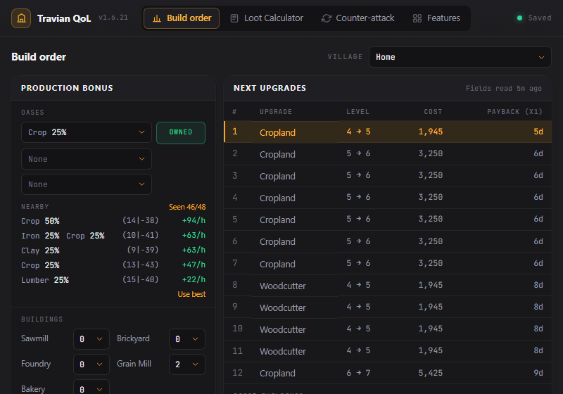</a>

<a href="images/farm-selection.png">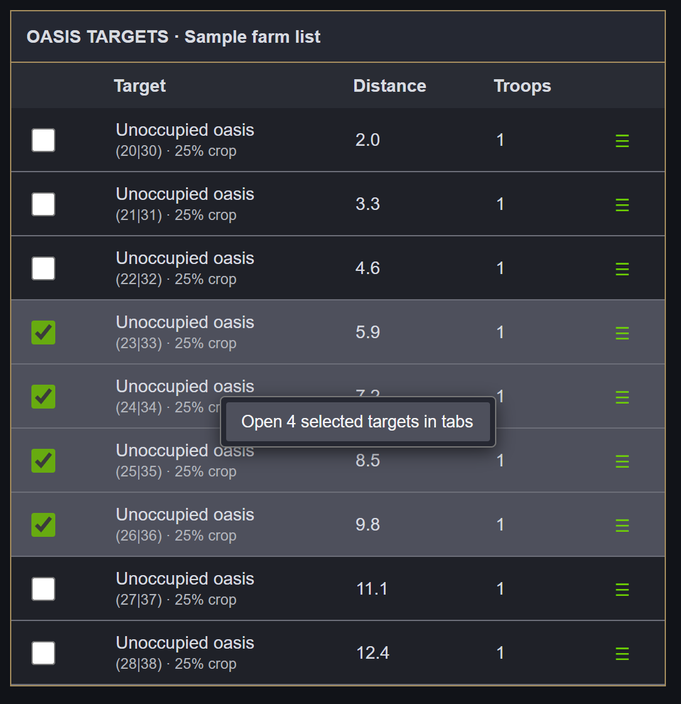</a>

The farm-list screenshot uses a sample table with the extension's selection highlight and menu.

## Rank Tracker

<a href="images/rank-tracker.png">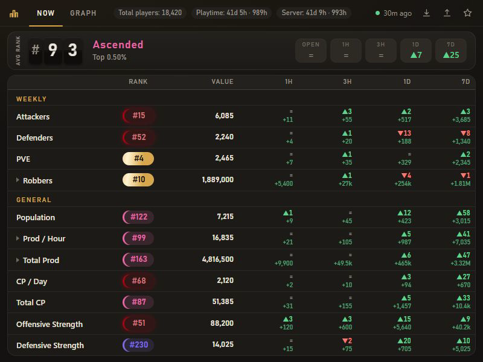</a>

**Features:** weekly Top 10 and general rankings; population, production, CP, attack/defense, raid/PvE statistics; average rank (all General ranks plus weekly PvE and Robbers) with percentile tier; table and average-rank comparisons over 1h, 3h, 1d and 7d; history graphs with raw data or 1h–1w interval averages, absolute values/per-hour rates, metric sections, saved groups, zoom, quick ranges (3h–1w), and point comparisons; header chips for total players, your playtime and time since server start; multiple servers; JSON export/import.

**Usage:**

1. Open a logged-in Travian tab and click the extension icon to register the server and collect statistics.
2. Use **Now** for rankings and changes. Expand **Prod / Hour** for Fields + raiding, Raids, and **Raids (no animals)**. The raid rates use the trailing hour; the no-animals row excludes 160 resources per animal killed. The status in the top bar shows the last update. Background collection runs approximately every 30 minutes while the browser and session are available. Weekly tables refresh when the popup is opened; the Weekly header shows when they were observed. Cached weekly values are not recorded as new history.
3. In **Graph**, use **Time Interval** to set how much history is visible and **Average Over** to group readings. Open **Filters → Overview → Average rank** to plot the overall rank from **Now**. The starting **Ranks** group includes general ranks plus weekly PvE and Robbers. Under **Production**, select **Fields** for field production, **Fields + raiding** for combined hourly income, or **Raiding** and **Raiding (no animals)** for the raid breakdown. Drag across the chart to compare two points. Scroll to zoom (Shift + scroll pans), or choose a range under **Time Interval**. Click the active range again to show all history. The comparison shows the change and time-weighted average plotted value across the selected range. **None/Raw** keeps individual readings. **1h**–**1w** average the readings in each period. **Per hour** shows the average gain per hour in each period, with a trailing 3-hour window for ungrouped raid and PvE gains. **Save group** stores the visible metrics; **Clear** hides all. Weekly statistics reset; value changes and hourly rates bridge observed resets rather than reporting the old total as a loss. Gains during missing observations cannot be recovered.
4. Use the export icon (arrow down) to save data. The import icon (arrow up) restores a backup and asks before deleting data the backup does not contain; export existing data before importing. The star icon lists the rank tiers.

For expired sessions, log in and reopen the popup. Missing observations cannot be reconstructed.

<a href="images/rank-history.png">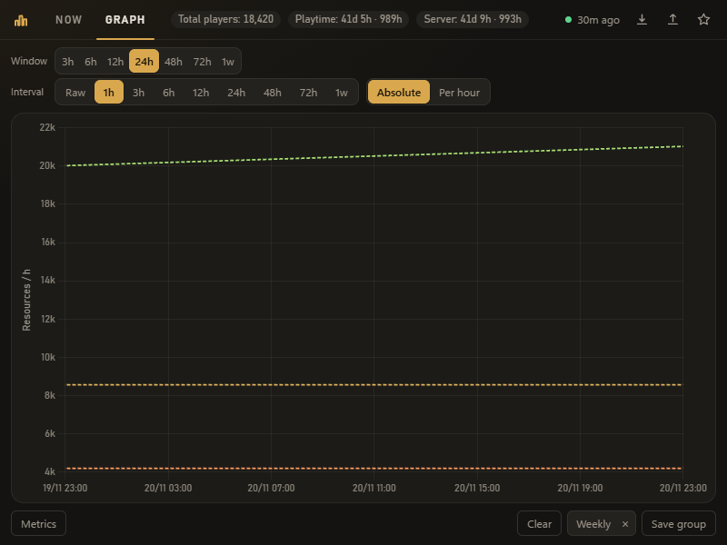</a>

<a href="images/rank-compare.png">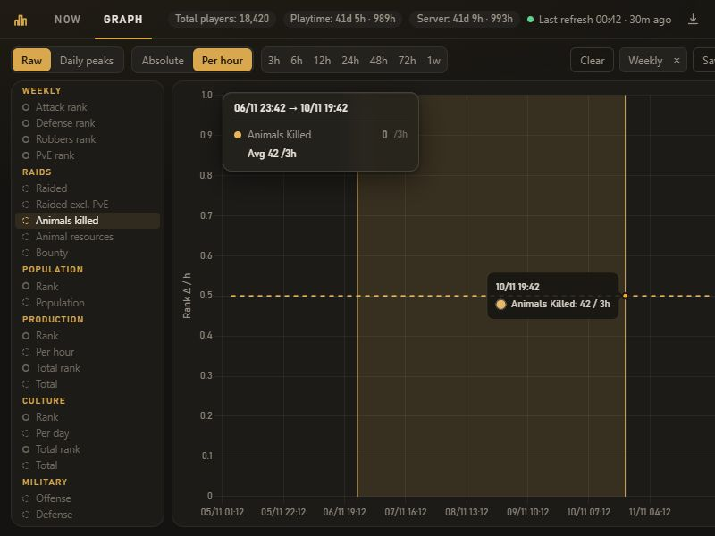</a>

## Next Settlement Calc

<a href="images/cp-planner.png">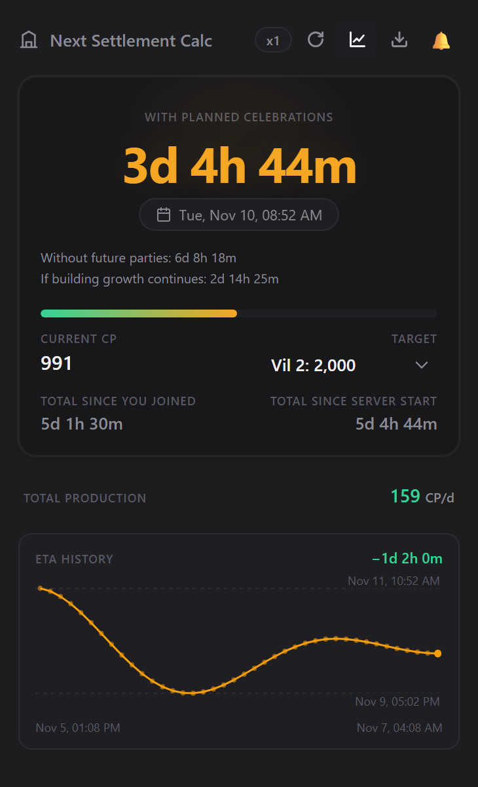</a>

**Features:** measured CP totals/production, settlement targets and ETA, per-village Town Hall levels, small/large celebration plans, cooldowns, repeated celebration queues, passive-growth projection, baseline forecast, readiness alarm/mute, total time from your account start and the server start to the ETA, ETA history chart (one chart per CP target, from the previous threshold to this one; 24h/48h/72h/7d/All ranges, ETA or CP/d series, baseline/growth overlays, trend, version markers, drag-to-compare), refresh, and forecast-log export.

**Usage:**

1. Open a logged-in game tab and **Next Settlement Calc**. It uses the active tab's server (otherwise the last one viewed). Select the settlement target; click **Refresh** for current data.
2. Check village production and Town Hall levels. Select planned small/large celebrations. Selecting both models small-then-large with cooldowns.
3. Compare the planned ETA with the baseline. You must supply resources and start the planned parties yourself. A running celebration's CP was paid at its start and is not counted again at completion.
4. Passive-growth estimates require observations spanning at least 12 hours. The readiness alarm uses observed/passive CP and plays its sound even with no game tab open; click the notification to dismiss it. Settling also requires settlers and a free expansion slot.

Click the chart button to show how the planned ETA for the selected target changed across logged forecasts. Choose a range (8h, 24h, 7d, 30d or All) and the **ETA** or **CP/d** series; toggle the **No parties** and **Parties + growth** overlays; the main line is the ETA **With parties**. Hover to read values along the line. Drag across the chart to show the change and time between two samples; click to clear it. The trend line and per-day trend appear with at least three samples over six hours. Dotted vertical lines mark extension version changes. Outliers, such as the very late ETAs logged right after a server start, are pinned to the chart edge and the axis label shows ≥ or ≤; hover them for the real value. Scroll over the chart to zoom in on a time span, Shift+scroll to pan, and double-click or **Reset zoom** to go back. The expand button opens the chart in its own resizable window.

Refreshes when you open the popup or click **Refresh**; there are no background requests. The account start is read once from the oldest system message in your inbox. Failed refreshes retain the last snapshot. Export the forecast log when reporting an incorrect ETA.

## Travian NPC Calculator

<a href="images/npc-calculator.png">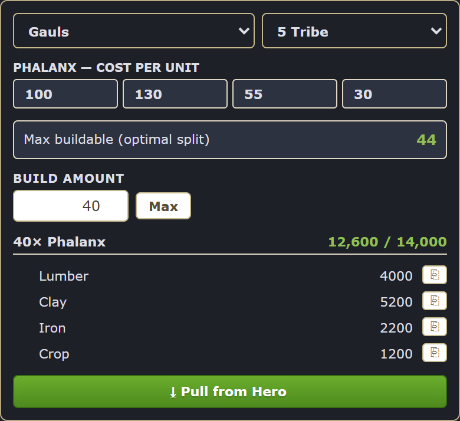</a>

**Features:** troop resource calculator, tribe/ruleset detection and overrides, unit costs, theoretical maximum count from the NPC pool, build amount, resource totals/copy buttons, per-resource deficits, saved/movable indicator, and hero-transfer assistance.

**Usage:**

1. In a training building, click the troop's **NPC exchange** control to open the calculator with that troop selected. A generic NPC dialog may lack the required troop context.
2. Check the tribe and ruleset: **3 Tribes Classic**, **5 Tribe**, or **6 Tribe Rebalanced**.
3. Enter **Build amount** or click **Max**. Max assumes an optimal NPC split of the total resource pool; actual recruitment also depends on stock distribution and queue conditions.
4. **Pull from Hero** normally opens the game's transfer dialog with target amounts. When a target is available, each required amount appears in amber parentheses. In night mode, projected stock turns muted green when it meets or exceeds that resource's target. In the light theme, projected stock uses the dialog’s neutral text color. Check amounts and destination before confirming.
5. If the native dialog is unavailable, **Pull from Hero** can navigate to hero inventory, fill the amounts, and submit the transfer automatically. A pull that doesn't reach the inventory within 30 seconds is dropped.
6. **FNPC** next to a build or training cost shows when the village can afford it with an NPC trade. It uses the village production and storage caps, plus returning raid bounties and incoming merchant deliveries. While an FNPC time is shown, the extension re-reads the active village's rally point and marketplace in the background, at most once every 5 minutes. Raids still on their way out are estimated from the village's raid bounty over the last hour.

## Travian Dark Mode

<a href="images/night-mode.png">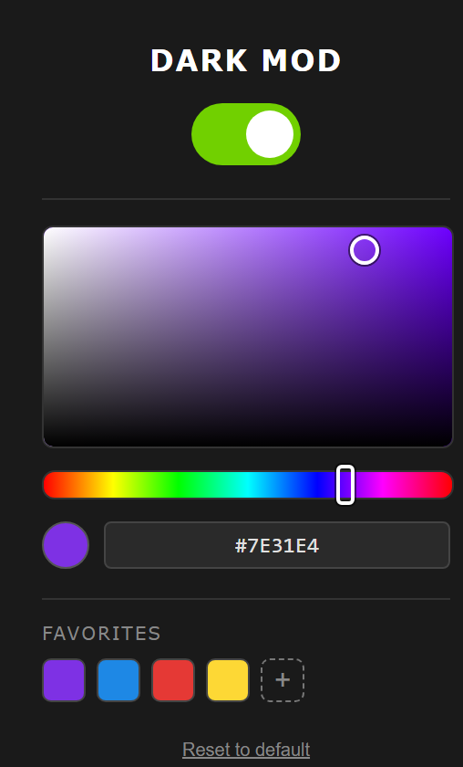</a>

**Features:** dark theme, night-time village and resource field assets, button-color picker/hex input, live preview, up to 12 saved favorites, and native button-color reset. The dark theme and night-time assets are enabled by default.

**Usage:**

1. Refresh Travian after installing. Toggle the theme from the toolbar popup.
2. Use **Nighttime village and field art** to switch the artwork while keeping the dark theme active.
3. Select a button color with the picker or hex field.
4. Click **+** to save a favorite; click a swatch to apply it or its delete control to remove it.
5. **Reset to default** restores native button colors.

## World Watch

<a href="images/world-watch.png">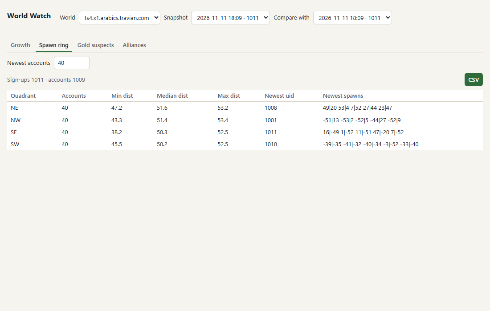</a>

**Features:** watch list of game worlds; hourly read-only fetch of each world's public `map.sql` (no login, no cookies); a snapshot is saved only when the dump changed (about once a day), 30 per world; dashboard with sign-up growth, spawn ring per quadrant, population gains per account with a 99th-percentile flag and radius filter, alliance centres, and a Travian-style map of new spawns and alliances; CSV export of every table.

**Usage:**

1. Click the extension icon on a Travian world tab to prefill its host, or enter a host such as `ts4.x1.arabics.travian.com` manually. Select **Add** to start the first fetch.
2. Set the check interval in minutes (15–1440, default 60). **Fetch now** checks every world immediately.
3. Select **Dashboard**. Pick the world, a **Snapshot** and a **Compare with** snapshot. Open any game page in that world once and **Your village** lists your villages; the selected one fills **Point (x|y)** and **Centre (x|y)**, and the map rings your villages blue. You can still type other coordinates.
4. **Growth** lists sign-ups (highest account id) per snapshot. **Spawn ring** shows, per quadrant, the distance range of the newest accounts' first villages; change **Newest accounts** to widen the sample.
5. **Gold suspects** ranks accounts by population gain between the two snapshots. Enter a point (`x|y`) and a radius to limit the list to accounts with a village nearby. Highlighted rows are above the 99th percentile; check **Δ villages**, because a new or conquered village also raises population.
6. **Map** opens at 100 % (60 px per field, as in game) on the newest spawn. Yellow villages are the newest accounts; the yellow band is their distance from 0|0. Coloured villages and labels are the top 10 alliances. Drag to pan, use the wheel or **+**/**−** to zoom down to the whole world, and enter **Centre (x|y)** to jump. Lines mark the world edge. Tick **Top 10** or **Top 100** to ring the largest accounts by population; Top 10 are labelled and listed in the legend. Hover a village for its owner.
7. **15c Finder** ranks saved 15c tiles by the crop bonus of the best three observed oases in the centered 3 × 3 area. Open DevTools (F12) in the game tab, reload the map at 100% and pan normally to collect tile data. Hover or open the tile details to save individual 15c matches with DevTools closed. The **Map** tab marks saved tiles with teal diamonds. Hover a diamond for the potential, how much was free when seen, and the number of nearby tiles checked. Confirm availability in-game. Collection is disabled on Europe 1.
8. **CSV** downloads the visible table.

<a href="images/world-watch-croppers.jpg">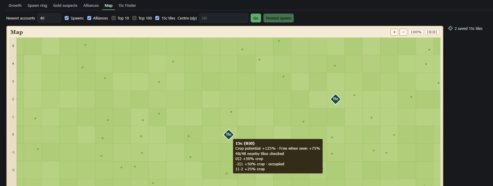</a>

Snapshot times are when the extension first saw new content, not when Travian generated the dump. Removing a world deletes its snapshots.

## Data and permissions

Preferences, timers, histories, and caches use extension storage. Some helpers use page local/session storage for context and transfer state. QoL feature toggles use browser sync storage when available.

Statistics tools use your existing game session; World Watch does not and sends no cookies; it reads your village list from game pages you open and keeps it in extension storage. World Watch stores snapshots in the extension's IndexedDB. Some tools open tabs, show notifications, or prepare resource transfers. Inspect each manifest for permissions. Oasis Finder answers read-only requests for its stored oasis coordinates and scan results from one other extension, identified by ID under `externally_connectable` in its manifest. That ID belongs to an unpublished companion extension (FarmList Pro); websites and other extensions cannot connect. Delete the `externally_connectable` block to turn this off. TravAlarm reads the public game world calendar at `lobby.legends.travian.com` to get the world start date for the oasis respawn countdown. Styles can load Google Fonts and a Travian-hosted button asset. No project-operated account or analytics service is included.

## Troubleshooting

- **No interface:** check domain support, extension enablement, and the loaded folder. Refresh the game page.
- **Stale data:** log into the correct world, reopen the popup, and check refresh status.
- **Conflicts:** disable the overlapping extension or QoL feature, then refresh.
- **Update errors:** reload the extension and game tabs. Copy errors from the extension manager.

Discord: **`luckimikey`**, or [open a GitHub issue](https://github.com/mikeymain/miguel-rocha-portfolio/issues/new/choose). Include extension/browser versions, server domain, reproduction steps, expected/actual behavior, and screenshots or errors. Remove private details; do not share passwords, cookies, or session tokens.

For development, edit files in the relevant extension folder, reload the extension, and refresh its game page.

## Copyright

Copyright © 2026 luckimikey. All rights reserved for original contributions to this repository.

Third-party code and assets retain their existing ownership and license terms.

## Credits

Travian and game artwork belong to their respective owners. Rank Tracker includes Chart.js with its license notice. QoL's ad helper credits DUDSS in its source.
