# Travian Extensions usage

[Project overview](../README.md) · [Installation](#install-in-brave-chrome-or-edge)

## Install in Brave, Chrome, or Edge

1. Download the zip for the extension you want from [Releases](https://github.com/mikeymain/miguel-rocha-portfolio/releases) and extract it. (Or select **Code → Download ZIP** on the repository page; the extensions are under `projects/travian-extensions/extensions`.)
2. Open `brave://extensions`, `chrome://extensions`, or `edge://extensions`.
3. Enable **Developer mode**.
4. Select **Load unpacked**, then choose the extracted extension folder (the one containing `manifest.json`).
5. Repeat for each extension you want to install. Refresh Travian tabs.
6. Pin extensions with toolbar popups. Oasis Finder, TravAlarm, and NPC AutoMerchant add controls to their matching pages.

No build step is required. Game features requiring a paid Travian option still require that option.

**Browsers:** desktop Chromium. Used in Brave; Chrome and Edge compatibility needs feedback. Firefox installation is not covered.

**Domains:** Oasis Finder, TravAlarm, and NPC AutoMerchant target `*.travian.com`. Rank Tracker also supports `.org`, `.net`, `.us`, and `.de`. Next Settlement Calc, QoL, and Night Mode support multiple regional domains; see their manifests.

### Updating and keeping your settings

Replace the files in the same installed folder, click **Reload** in the extension manager, and refresh game tabs. Moving or reinstalling an extension can lose saved data. Export Rank Tracker data before changing installations.

## Oasis Finder

<a href="images/oasis-finder.png">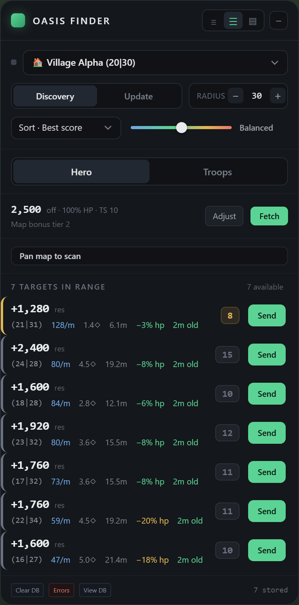</a>

**Features:** Discovery/Update modes, scan coverage, local oasis database, observation ages, Hero/Troops views, hero-stat fetch, troop counts and smithy levels, optional hero inclusion, troop preview/cap, five risk levels, sort controls, density controls, draggable/collapsible panel, database and error viewers. Native farm-list name sorting groups oases by bonus type, then distance.

**Usage:**

1. Open the map, select the origin village, and set the radius.
2. Select **Discovery** and pan the map to collect oasis data. Use **Update** to refresh known targets. The coverage meter shows observed areas.
3. In **Hero**, click **Fetch** and check health, Tournament Square level, and map bonus under **Adjust**. In **Troops**, fetch or enter counts and smithy levels; set hero inclusion, preview unit, and troop cap.
4. Choose a risk level and sort: **Best score**, **Net resources**, **Res / minute**, **Distance**, or **Res / HP**. Net resources includes modeled troop losses.
5. Check observation age and current garrison before raiding. Coordinates open the map; **Send** opens a prefilled rally-point page. Sending the raid requires confirmation in the game.

Unknown-age or incomplete readings are excluded. **Errors** shows scan problems, and **Clear DB** deletes the oasis cache. In **Detail** density, each target shows its garrison, score, hero XP and res/HP.

**View DB** lists every stored oasis:

- Search by coordinates or animal name. Filter by oasis type (Lumber, Clay, Iron or Crop) and by **With animals** or **No animals**.
- **From** sets the origin: one of your villages, or **Coordinate** to enter any `x|y`. **Radius** limits the list to that distance.
- Click a column header to sort by location, distance, type, garrison, resources or last seen. Click again to reverse.
- **Open N** opens the listed oases in background tabs, in the current sort order. It needs a radius, asks first at 10 or more, opens at most 50 per click, and spaces the tabs 0.35–0.75 s apart.

<a href="images/oasis-database.png">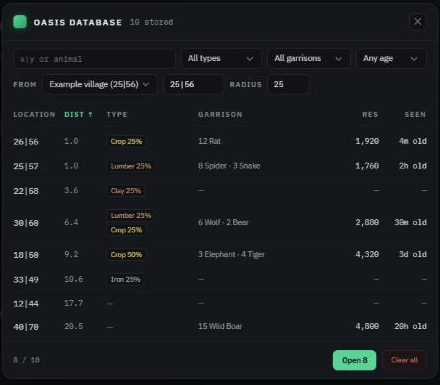</a>

<a href="images/oasis-troops.png">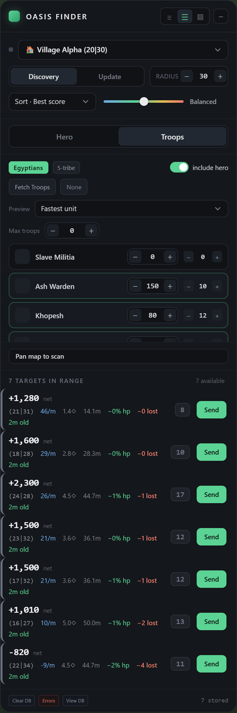</a>

## TravAlarm

<a href="images/travalarm.png">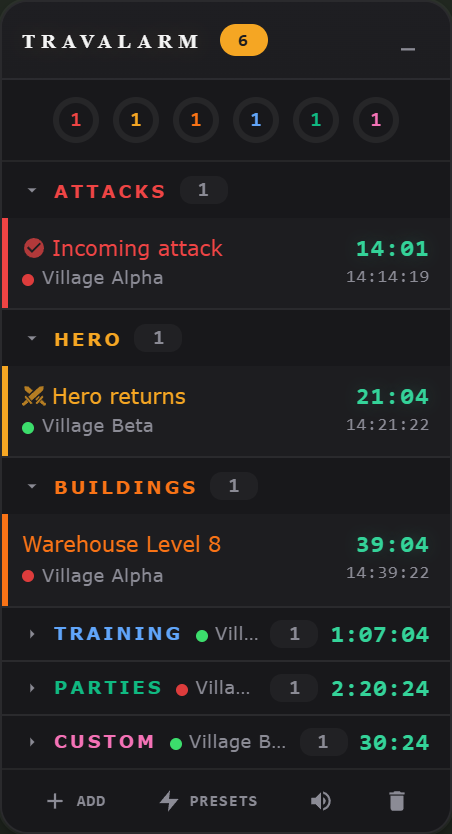</a>

**Features:** grouped timers for attacks, hero movements, construction, training, storage, celebrations, and farm lists; village labels/colors; custom reminders; recurring/daily presets; countdowns; pin/delete controls; draggable/collapsible panel; category sound settings; volume; browser alarms and notifications; an **Oasis respawn** countdown to the end of the world's starting beginner protection, when oasis animals begin to respawn, with alarms 45 minutes before and at the protection end.

**Usage:**

1. Open Travian and visit the relevant game pages to populate timers. Expand a category to view its alarms.
2. Click **Add** for a custom reminder. Durations: `15` = 15 minutes, `1:30` = 1 minute 30 seconds, `0:45:00` = 45 minutes. `10pm` schedules the next occurrence on your computer's clock.
3. Use **Presets** for reusable reminders. Pin or delete timers with their controls.
4. Set volume, enabled categories and the **All sounds** mute under **Sound Settings**. Allow browser notifications for desktop alerts.

Timers depend on available game data. Browser shutdown, computer sleep, expired sessions, and muted audio can affect alerts.

TravAlarm refreshes game data only while its Travian tab is visible (a second monitor works) and the computer has had input in the last 10 minutes. Hidden tabs, an idle computer or a locked screen pause requests; new attacks are picked up when you return.

## Travian QoL

<a href="images/qol-settings.png">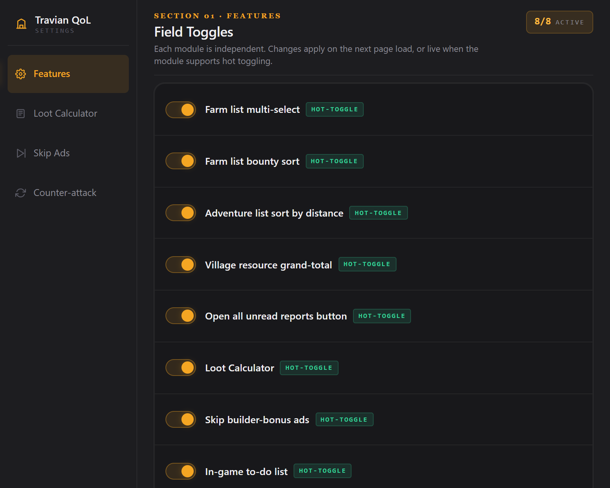</a>

Open the toolbar popup or **Options** page. Features are enabled by default and have separate toggles. **Hot-toggle** applies immediately; **On refresh** requires reloading the page.

| Feature | Usage |
| --- | --- |
| Farm-list multi-select | Click a checkbox to set an anchor. **Shift-click** changes a range to the opposite of the anchor's checked state; **Ctrl/Cmd-click** toggles a row. Checked rows are highlighted. Clicking outside lists clears selection. Check the resulting selection before sending raids. |
| Open selected farm targets | **Right-click a checked row → Open N selected targets in tabs**. Opens unique map links from that list in background tabs. No raids are sent. Escape, scrolling, or an outside click closes the menu. |
| Farm-list bounty sort | Choose **By bounty**. Orders by last bounty descending, then distance ascending for ties. Persists through list updates until another sort is selected. |
| Adventure distance sort | Open the hero adventure list. Adventures appear nearest first. |
| Village resource grand-total | Adds wood + clay + iron + crop totals beside village names on per-village resource/production statistics. |
| Open unread reports | Click **Open Unread** beside Archive. Opens unread reports from the displayed page in background tabs. |
| Loot Calculator | Select resource text, then **right-click → Calculate Troops Needed**. Choose tribe and carrying unit. Reports also show unit-count badges. Set default/per-server units in the **Loot Calculator** settings tab. |
| In-game to-do list | Add, edit, reorder, and complete village-specific tasks. Lists are saved locally; the widget can be dragged or collapsed. |
| Skip builder-bonus ads | Mutes video-feature ads you start and moves them to a corner so the page stays usable; links you open meanwhile load in an overlay so the ad keeps playing. Announces when the ad finishes. The ad always plays at normal speed, and the extension never starts an ad on its own. |
| Counter-attack calculator | In **Counter-attack**, enter coordinates, troop/server speeds, bonuses, and attack timings to calculate return/interception times. |

<a href="images/farm-selection.png">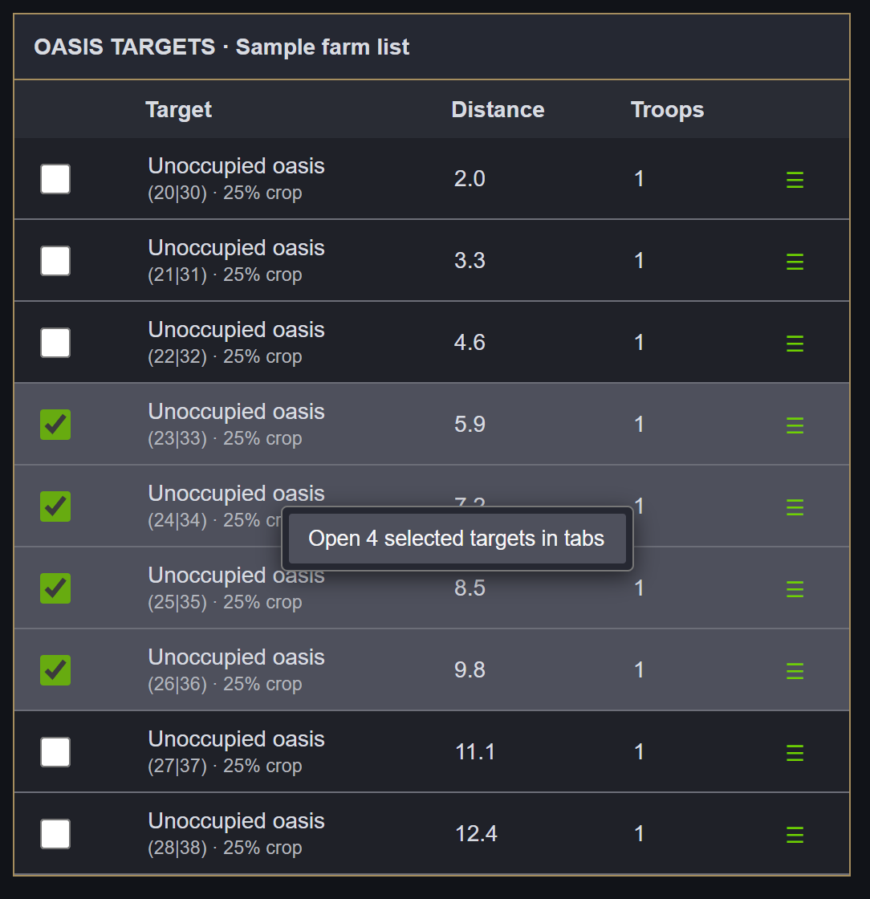</a>

The farm-list screenshot uses a sample table with the extension's selection highlight and menu.

## Rank Tracker

<a href="images/rank-tracker.png">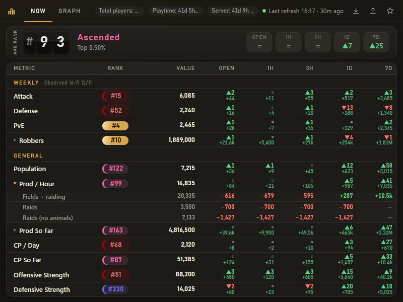</a>

**Features:** weekly Top 10 and general rankings; population, production, CP, attack/defense, raid/PvE statistics; average rank (population, production, CP) with percentile tier; changes since last open and over 1h, 3h, 1d and 7d; history graphs with raw data/daily peaks, absolute values/per-hour rates, metric sections, saved groups, zoom, and point comparisons; header chips for total players, your playtime and time since server start; multiple servers; JSON export/import.

**Usage:**

1. Open a logged-in Travian tab and click the extension icon to register the server and collect statistics.
2. Use **Now** for rankings and changes. The status in the top bar shows the last update. Background collection runs approximately every 30 minutes while the browser and session are available. Weekly tables refresh when the popup is opened; the Weekly header shows when they were observed. Cached weekly values are not recorded as new history.
3. Use **History** to pick metrics in the sidebar, drag across the chart to compare two points, and scroll on the chart to zoom (Shift + scroll pans). **Daily peaks** aggregates observations; **Per hour** shows change per hour; raid and PvE counters show the total gained in the trailing 3 hours. **Save group** stores the visible metrics; **Clear** hides all. Weekly statistics reset; value changes and hourly rates bridge observed resets rather than reporting the old total as a loss. Gains during missing observations cannot be recovered.
4. Use the export icon (arrow down) to save data. The import icon (arrow up) restores a backup and asks before deleting data the backup does not contain; export existing data before importing. The star icon lists the rank tiers.

For expired sessions, log in and reopen the popup. Missing observations cannot be reconstructed.

<a href="images/rank-history.png">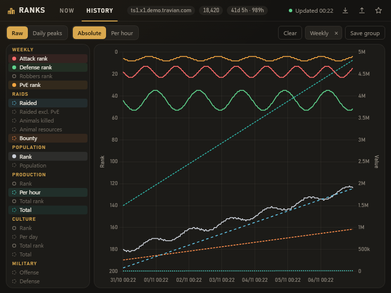</a>

## Next Settlement Calc

<a href="images/cp-planner.png">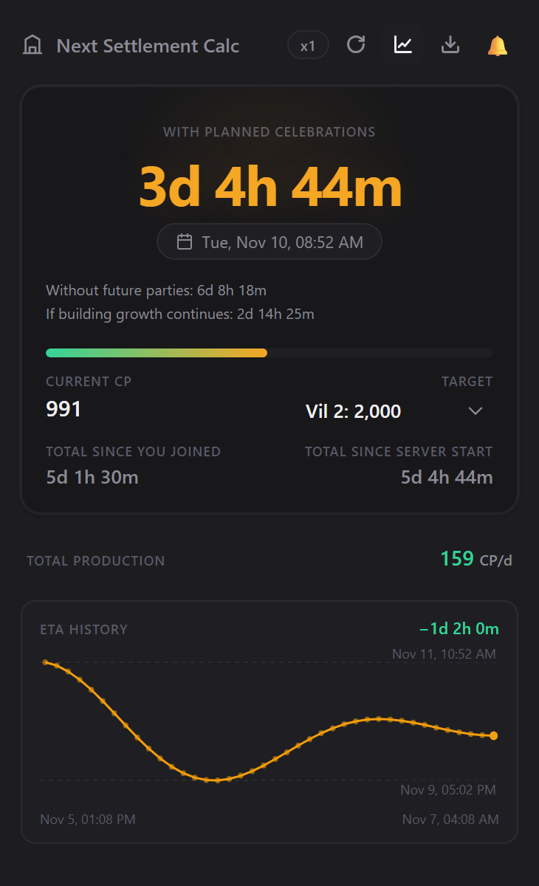</a>

**Features:** measured CP totals/production, settlement targets and ETA, per-village Town Hall levels, small/large celebration plans, cooldowns, repeated celebration queues, passive-growth projection, baseline forecast, readiness alarm/mute, total time from your account start and the server start to the ETA, ETA history chart (24h/7d/30d/All ranges, ETA or CP/d series, baseline/growth overlays, trend, version markers, drag-to-compare), refresh, and forecast-log export.

**Usage:**

1. Open a logged-in game tab and **Next Settlement Calc**. It uses the active tab's server (otherwise the last one viewed). Select the settlement target; click **Refresh** for current data.
2. Check village production and Town Hall levels. Select planned small/large celebrations. Selecting both models small-then-large with cooldowns.
3. Compare the planned ETA with the baseline. You must supply resources and start the planned parties yourself. A running celebration's CP was paid at its start and is not counted again at completion.
4. Passive-growth estimates require observations spanning at least 12 hours. The readiness alarm uses observed/passive CP and plays its sound even with no game tab open; click the notification to dismiss it. Settling also requires settlers and a free expansion slot.

Click the chart button to show how the planned ETA for the selected target changed across logged forecasts. Choose a range and the **ETA** or **CP/d** series; toggle the **No parties** and **Parties + growth** overlays; the main line is the ETA **With parties**. Hover for the sample's values. Drag across the chart to show the change and time between two samples; click to clear it. The trend line and per-day trend appear with at least three samples over six hours. Dotted vertical lines mark extension version changes. Outliers, such as the very late ETAs logged right after a server start, are pinned to the chart edge and the axis label shows ≥ or ≤; hover them for the real value. Scroll over the chart to zoom in on a time span, Shift+scroll to pan, and double-click or **Reset zoom** to go back. The expand button opens the chart in its own resizable window.

Refreshes when you open the popup or click **Refresh**; there are no background requests. The account start is read once from the oldest system message in your inbox. Failed refreshes retain the last snapshot. Export the forecast log when reporting an incorrect ETA.

## NPC AutoMerchant

<a href="images/npc-calculator.png">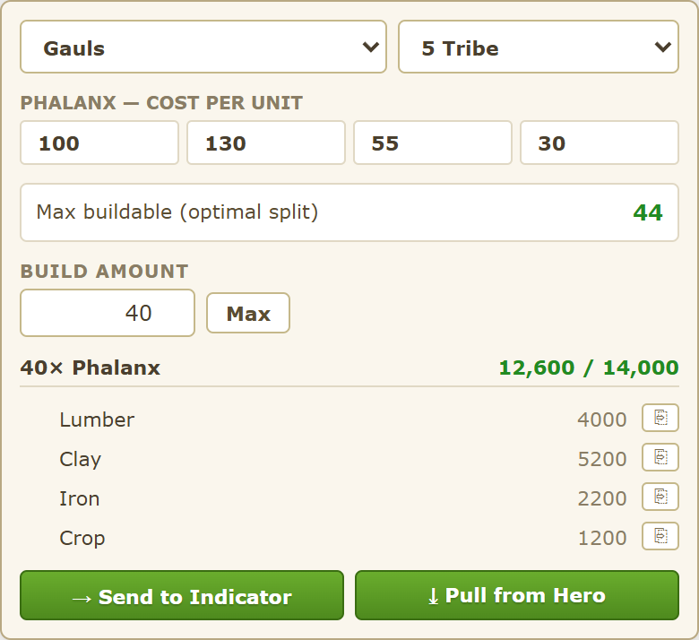</a>

**Features:** troop resource calculator, tribe/ruleset detection and overrides, unit costs, theoretical maximum count from the NPC pool, build amount, resource totals/copy buttons, per-resource deficits, saved/movable indicator, and hero-transfer assistance.

**Usage:**

1. In a training building, click the troop's **NPC exchange** control to open the calculator with that troop selected. A generic NPC dialog may lack the required troop context.
2. Check the tribe and ruleset: **3 Tribes Classic**, **5 Tribe**, or **6 Tribe Rebalanced**.
3. Enter **Build amount** or click **Max**. Max assumes an optimal NPC split of the total resource pool; actual recruitment also depends on stock distribution and queue conditions.
4. **Send to Indicator** saves the resource shortfall for the marketplace indicator, which offers **Pull ÷4** only when the total pool is short. **Pull from Hero** normally opens the game's transfer dialog with target amounts. Check amounts and destination before confirming.
5. If the native dialog is unavailable, **Pull from Hero** can navigate to hero inventory, fill the amounts, and submit the transfer automatically. A pull that doesn't reach the inventory within 30 seconds is dropped.

## Night Mode

<a href="images/night-mode.png">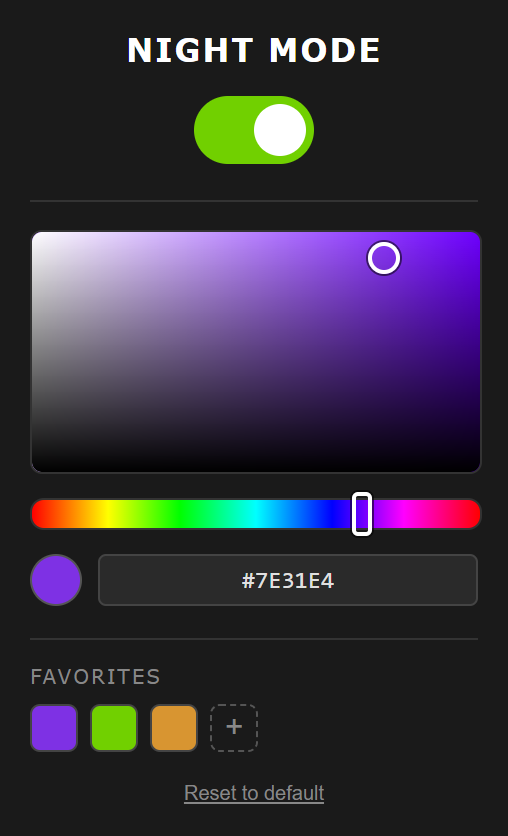</a>

**Features:** dark theme, toolbar toggle, button-color picker/hex input, live preview, up to 12 saved favorites, and native button-color reset. Enabled by default.

**Usage:**

1. Refresh Travian after installing. Toggle the theme from the toolbar popup.
2. Select a button color with the picker or hex field.
3. Click **+** to save a favorite; click a swatch to apply it or its delete control to remove it.
4. **Reset to default** restores native button colors.

## Data and permissions

Preferences, timers, histories, and caches use extension storage. Some helpers use page local/session storage for context and transfer state. QoL feature toggles use browser sync storage when available.

Statistics tools use your existing game session. Some tools open tabs, show notifications, or prepare resource transfers. Inspect each manifest for permissions. Oasis Finder answers read-only requests for its stored oasis coordinates and scan results from one other extension, identified by ID under `externally_connectable` in its manifest. That ID belongs to an unpublished companion extension (FarmList Pro); websites and other extensions cannot connect. Delete the `externally_connectable` block to turn this off. TravAlarm reads the public game world calendar at `lobby.legends.travian.com` to get the world start date for the oasis respawn countdown. Styles can load Google Fonts and a Travian-hosted button asset. No project-operated account or analytics service is included.

## Troubleshooting

- **No interface:** check domain support, extension enablement, and the loaded folder. Refresh the game page.
- **Stale data:** log into the correct world, reopen the popup, and check refresh status.
- **Conflicts:** disable the overlapping extension or QoL feature, then refresh.
- **Update errors:** reload the extension and game tabs. Copy errors from the extension manager.

Discord: **`luckimikey`**, or [open a GitHub issue](https://github.com/mikeymain/miguel-rocha-portfolio/issues/new/choose). Include extension/browser versions, server domain, reproduction steps, expected/actual behavior, and screenshots or errors. Remove private details; do not share passwords, cookies, or session tokens.

For development, edit files in the relevant extension folder, reload the extension, and refresh its game page.

## Copyright

Copyright © 2026 luckimikey. All rights reserved for original contributions to this repository.

Third-party code and assets retain their existing ownership and license terms.

## Credits

Travian and game artwork belong to their respective owners. Rank Tracker includes Chart.js with its license notice. QoL's ad helper credits DUDSS in its source.
