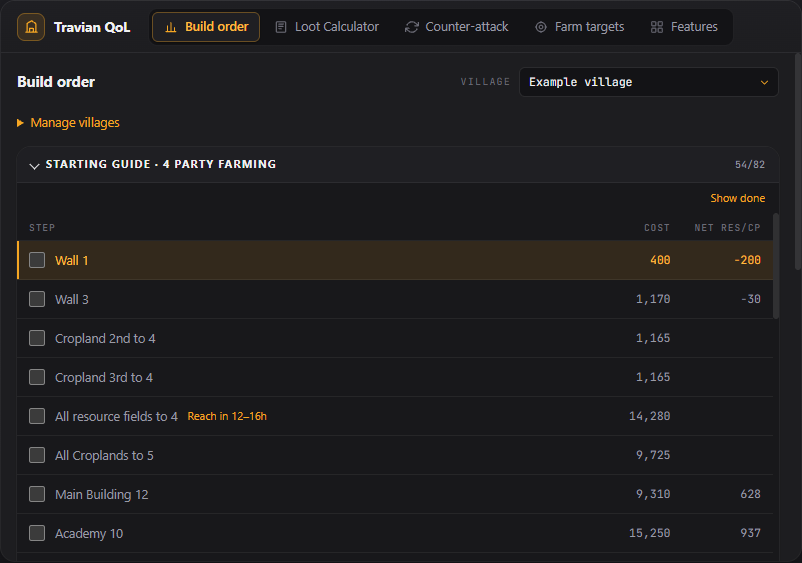
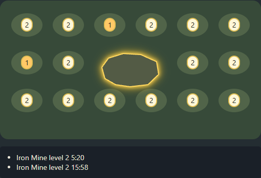

# Starting guide: 4 party farming

Travian QoL → settings → **Build order** → **Starting guide · 4 party farming**.

The step list follows the 4 party farming start from the community "Settling" spreadsheet by Caim (tab *2 - 4P - Farming*, marked there as being tested). Costs, rewards, culture points (CP) and population are the sheet's Roman numbers; building costs are the same for every tribe. Farm unit counts and costs are tribe specific and left as manual steps.

## How it works

- Timing goals are measured from your start. Aim to reach **All resource fields to 4** in **12–16 hours** and start **Party 1** by **48 hours**.

  

- A step is ticked automatically when the game shows it done: resource field levels come from the resources view, building levels from the village centre. Open both once per village.
- Counts are cumulative. "Cropland 1x to 4" followed by "Cropland 2nd to 4" needs two croplands at level 4.
- For **All** field steps, upgrade in rounds. The guide highlights the lowest available field among the requested types, so fields at the same level take turns before the next round.
- Population and CP/day targets tick when the village reaches the listed value. The guide reads population from the sidebar and CP/day from the village culture points overview. Tick tasks, parties, settlers and troops by clicking the step name or its checkbox. **Hide done** and **Show done** are remembered when you reopen the guide.
- With one village on the world, the guide leads the Build order tab and highlights the next field, building or empty slot. When the next step is a building, the village-centre hotspot glows on the resources map. Open the village centre once so the guide can read building levels. The payback highlight returns once the second village is settled. The guide then starts collapsed at the bottom of the tab.

  

- The in-game glow pauses while the build queue is full and returns when a slot opens.

- To reuse a village's building positions, visit its resources and village centre, select it in **Build order**, then open the guide and click **Use this village layout**. The saved layout supplies preferred slots across worlds. If the preferred slot is occupied, the guide selects another free slot. Open the highlighted slot to see the building choice marked in the construction menu.
- The highlighted row is the next required step. **Optional** rows are skipped by the highlight and the progress count.
- The guide can highlight the next field, building or empty slot while the queue is full. For all-field steps it skips fields already under construction. Single-field steps keep their target through intermediate upgrades. Buildings already under construction and steps ticked by hand are skipped.
- **Cost** is the sheet's cost. **Net res/CP** is (cost - task reward) / CP per day gained, for steps that give CP.

## Improvements found

Computed from the sheet's own numbers (`features/build-order/guide-4p.js`, tested in `tests/travianqol-guide.test.cjs`).

1. **Net cost per CP.** Most expensive steps: Residence 10 (5,967), Residence 7 (4,053), Smithy 3 (2,570), Warehouse 7 (2,198), Residence 3 (2,185), Barracks 3 (1,535), Granary 7 (1,258). Cheapest: crannies 7x to 3 (255) and to 7 (818). Residence 10 is needed for the settlers, and Barracks 3 and Smithy 3 unlock the Academy and Stable, so none can be dropped. Place them next to reward-paying steps.
2. **Level 5 fields after party 1 are optional.** The sheet's own ROI estimates for level 5 fields are 67 to 83 hours, against a settle time of about 95 to 120 hours. Level 5 wood, clay and iron are marked optional.
3. **Iron mines.** The sheet advises against iron mines. The early iron steps (levels 2 to 4) cost 7,175 and pay 4,500 in task rewards for 8 CP per day, about 334 res per CP, cheaper than any building in the sheet's cheap CP list, so they stay in the main path. Level 5 iron (8,400 cost, 2,700 reward, no CP) is the weakest step and is optional.
4. **Cheap CP tail.** The sheet's list of the cheapest CP per resource buildings (1,033 to 1,360 res per CP: Embassy 9 to 12, Main Building 14 to 16, Academy 11 and 12, Marketplace 14, Rally Point 3) is added at the end as optional steps, for when CP runs short before party 4.

## To verify in game

- The sheet's *Tasks* tab lists the second tier of Main Building, Granary, Warehouse, Marketplace, Cranny and Wall tasks at level 10, but the guide pays that tier's reward at level 3 or 6. Barracks 1 and Rally Point 1 show 300 on the *Tasks* tab and 600 in the guide. If your server's tasks follow the *Tasks* tab, the net costs above are too low for those steps and the best order may change. Compare with your in-game task list.
