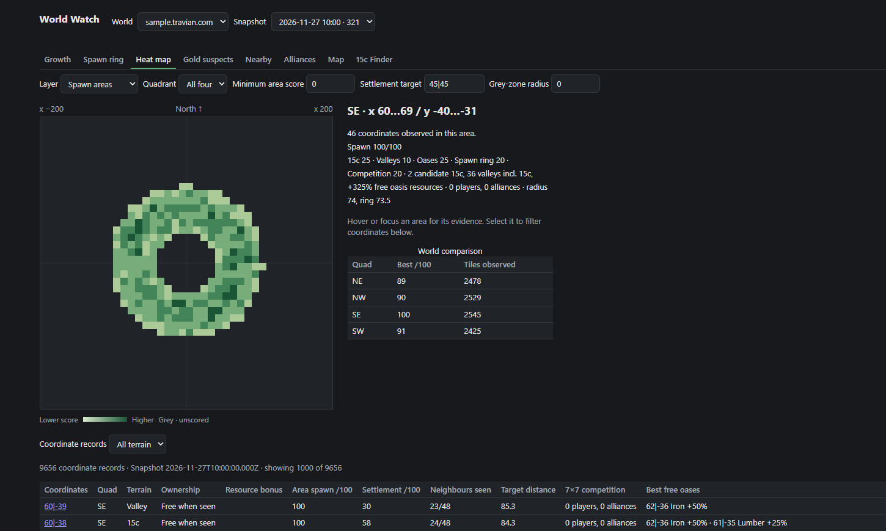

# Travian World Watch

Tracks a Travian Legends game world over time from its public `map.sql` dump. Use it to choose a spawn area and to spot accounts with unusual population growth.

## How it works

- Open the popup on a Travian world tab to prefill its host. You can edit the host before selecting **Add**.
- A `chrome.alarms` job (every 60 minutes by default, 15–1440 allowed) fetches `https://<host>/map.sql` for each host, one after another, 3 seconds apart.
- Requests send no cookies (`credentials: "omit"`). They are read-only and need no login.
- A snapshot is stored only when the SHA-256 of the dump changed. Travian appears to regenerate `map.sql` about once a day, so most hourly checks store nothing.
- World Watch also saves successful same-world `map.sql` fetch and XHR responses it observes in an open game map for a watched world. They use the same snapshot history and retention as scheduled downloads.
- **No map data yet** means Travian returned an empty download. World Watch keeps existing snapshots and checks again at the scheduled interval. Select **Fetch now** to check sooner.
- Snapshots are kept in IndexedDB in columnar form (`x, y, tribe, vid, uid, aid, pop` plus player names and alliance tags). The newest 30 per host are kept.
- The dump has no generation time. A snapshot's time is the time of the first fetch that saw the new content, so it can be up to one interval late.

## Dashboard

| View | Content |
| --- | --- |
| Growth | Per snapshot: sign-ups (highest uid), Δ sign-ups, accounts, villages, population. |
| Spawn ring | Per quadrant (NE/NW/SE/SW): the newest N accounts by uid (default 40). Spawn village = lowest village id per account. Min, median and max distance from 0\|0 and the newest spawn coordinates. |
| Nearby | Every village within a radius of a centre (your selected village by default), nearest first. Your own villages are pinned at the top (blue) for comparison, whatever their distance; **Open all** skips them. Status per account between Snapshot and Compare with: inactive (no pop growth), new (not in the older snapshot) or active; inactive rows are highlighted. The tab switches Compare with to the newest snapshot at least 24 h older. **Inactive only** filters the list. **Open all** opens the listed villages' game pages in background tabs, one at a time with random 1.5–4 s gaps, up to 100 tabs, with a Stop button. The radius is remembered. |
| Gold suspects | Population gain per account between two snapshots, gain per hour, Δ villages and distance to a point. Rows above the 99th percentile gain are highlighted. Only accounts present in both snapshots are compared. A Δ villages above 0 means part of the gain comes from a new or conquered village. |
| Alliances | Members, villages, population, population-weighted centre and main quadrant. |
| 15c Finder | Confirmed `1-1-1-15` tiles ranked by the best three observed crop bonuses in their centered 3 × 3 area. The table shows the potential, how much was free when observed, and how much of the area was checked. Click a coordinate to reopen the tile. |
| Map | Travian-style map: 60 px per field at 100 %, like the in-game map. The window fills the free page area (at least 543 × 401 px, the in-game size). Zoom from 100 % down to the whole world; drag to pan, mouse wheel to zoom. The map wraps in both directions at every zoom level. Lines mark the seams at ±200. Newest spawns are highlighted and their distance band from 0\|0 is shaded; the top 10 alliances are coloured and labelled at their centre. **Top 10** and **Top 100** mark the largest accounts by population (red and white rings); Top 10 are labelled with rank and name at their largest village. Hover a field for player, alliance, population and rank. |

**Your village:** `own-village.js` reads your player name and village list (names and coordinates) from the game sidebar on any page you open in that world, and stores them per world. The dashboard then shows a **Your village** selector, fills **Point (x|y)** and **Centre (x|y)** with the selected village (the inputs stay editable; a typed value is not overwritten), and rings your villages blue on the map. In **Gold suspects**, your account is pinned to the top row (blue), regardless of radius or the p99 filter, so you can compare it with the other players.

Every table exports to CSV. Nature and Natar villages are ignored. Positive y is north. Distances wrap around the 401 × 401 map.

**Finding a 15c:** Open the map in the game tab and pan normally. World Watch reads the game's completed map responses and saves confirmed `1-1-1-15` coordinates locally, even if the world is not on the watch list. Hover over a valley or open its details to save individual matches. Check the tile in-game before settling. Terrain collection is disabled on Europe 1 (`ts1.x1.europe.travian.com`).

**Map grid scan:** Open the game map at 100% zoom, then open the World Watch popup. Enter a centre (`x|y`), select a radius of 5, 10 or 15 tiles, and choose **Start scan**. The scan visits 9, 25 or 49 map centres in the same game tab, five tiles apart, and waits for each view to save before moving on. Reopen the popup to check progress or select **Stop scan**. The scan also stops if the tab leaves the route or a view does not return usable tiles. Reload the game map after updating the extension so the capture scripts can run.

**Mapping and comparing 15c tiles:** Pan at 100% zoom to collect nearby oasis bonuses. In World Watch, the **Map** tab shows teal diamonds for saved 15c tiles, including worlds without a snapshot. Hover a marker for the best observed bonuses and coverage. Crop potential can include occupied oases. **Free when seen** counts only oases that were unoccupied at their last observation. Both totals are limited to three oases and reflect the eight adjacent tiles in the finder’s 3 × 3 scoring area. Verify ownership and settlement availability in-game.

## Heat map

Open **Dashboard → Heat map** and choose a world. Open its game map at 100% zoom and pan through the areas you want to compare. Each completed map response contributes a batch. The dashboard joins the latest observed terrain to the selected population snapshot. A blank area has no displayed observations. Grey cells have observations but no eligible observed valleys.

| Layer | How the 100 points are assigned |
| --- | --- |
| Spawn areas | Each roughly 10×10 cell earns up to 25 points for two candidate 15c tiles, 10 for ten observed candidate valleys including 15c, and 25 for a combined 300% of free oasis resource bonuses. Proximity to the quadrant's median spawn radius earns up to 20, falling to zero at a 30-field difference. Competition earns up to 20, falling to zero at ten distinct players plus alliances in the cell. The ring uses the newest 40 accounts per quadrant. |
| First settlement | Each candidate earns 35 terrain points for a confirmed 15c or 10 for another confirmed valley. Up to 30 points come from the best three observed free oases in the wrapped 7×7 area (crop at full value, other resources at half, 150% for full points). Distance to the target earns 20 at the target and zero at 30 fields. Competition earns up to 15, falling to zero at six distinct players plus alliances in the surrounding 48 fields. A cell displays its highest-scoring candidate. |

The weights are planning heuristics. Missing inputs earn zero for that component. The target defaults to your selected village when available. Enter an expected spawn coordinate to compare travel distances instead. Set **Grey-zone radius** to your world's confirmed circular exclusion radius around 0|0. Zero leaves this optional filter off. Known occupied and excluded sites stay in the coordinate records and receive no settlement score. Layouts hidden by settled villages require an earlier observation. Snapshot competition covers the player villages in World Watch's dump parser. Check ownership in-game before settling.

Compare each quadrant's best score alongside its observed tile count. Hover or focus a cell to inspect its points, then select it to filter the table. Filter by layer, quadrant, minimum area score or record type. **CSV** exports all matching coordinate records, including the evidence behind each score and available timestamps. Older captures retain their known crop bonuses. Revisit an area to collect other resources, ownership and observation times.

## Live mode

`WWCore.fetchLive(host)` in `lib/core.js` is the hook for a logged-in mode. With a session in that world, same-origin `POST /api/v1/graphql` answers; without one it returns 401. v1 does not use it.

## Files

| File | Role |
| --- | --- |
| `lib/mapsql.js` | `map.sql` parser and snapshot summary |
| `lib/analysis.js` | Spawn ring, gold suspects, alliances, growth, CSV |
| `lib/core.js` | Host validation, settings, poll and dedupe |
| `lib/db.js` | IndexedDB store |
| `background.js` | Alarm and messages |
| `map-interceptor.js`, `map-capture.js`, `lib/croppers.js` | Observe game map fetch/XHR responses, forward public dumps, and identify terrain |
| `lib/map-scan.js` | Navigate the game tab and wait for saved map views |
| `cropper-collector.js` | Read 15c valley tooltips |
| `own-village.js` | Content script: your villages from the game sidebar |
| `map-view.js` | Map canvas |
| `popup.*`, `dashboard.*` | UI |

Tests: `tests/worldwatch.test.cjs` (`cd tests && node --test worldwatch.test.cjs`).
